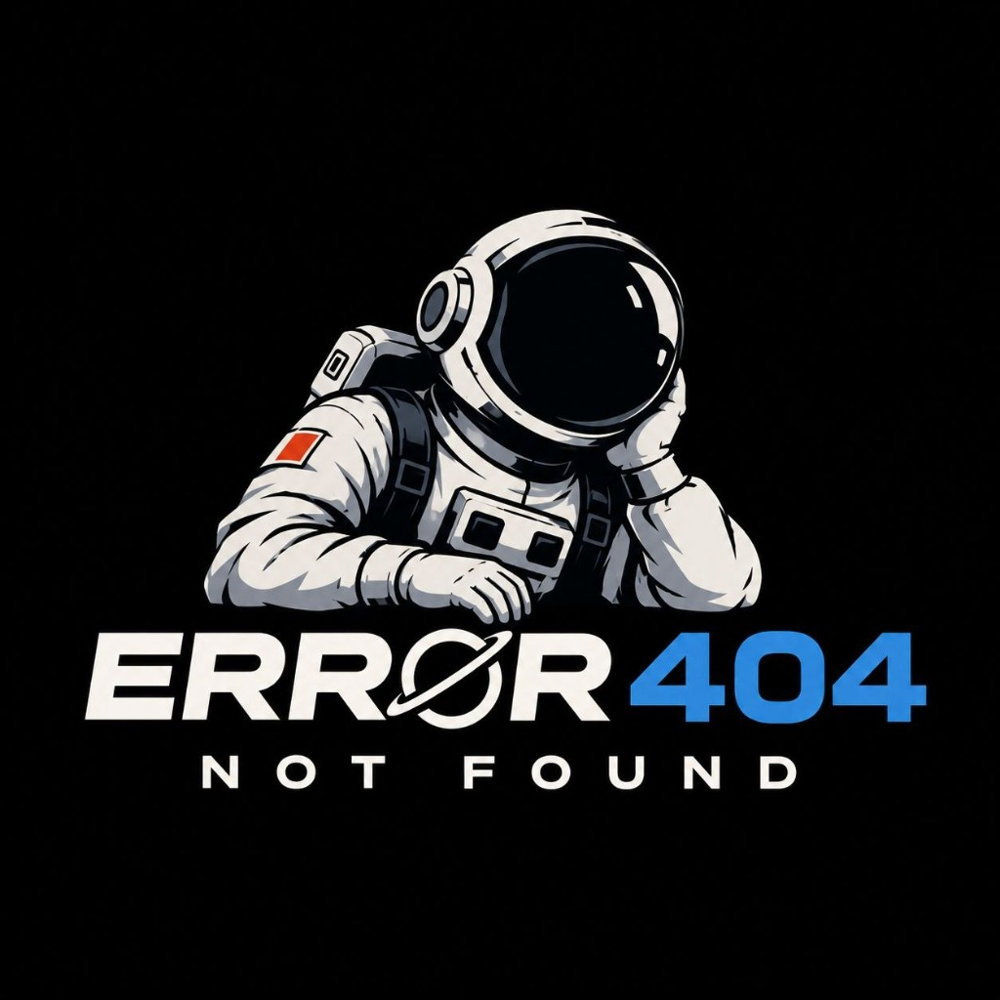

# Error 404 — Earth System Trend Detective
### NASA Space Apps Challenge 2026



> **Team Error 404** · NASA Space Apps Challenge 2026  
> *Interactive 3D Earth System Trend Detection, Multidecadal Satellite Observation & Statistical Anomaly Analysis*

---

## 🌍 Overview

**Earth System Trend Detective** is an interactive, scientific 3D Earth observation workspace created for the **NASA Space Apps Challenge 2026** by team **Error 404**.

The platform couples high-resolution satellite imagery from NASA's Earth Observing System Data and Information System (**EOSDIS**) and Global Imagery Browse Services (**GIBS**) with rigorous statistical trend detection algorithms. It empowers researchers, students, and citizens to track long-term environmental transformations across planetary spheres over more than two decades (2000–2026).

---

## 🚀 Key Features

### 1. Dual Workspace Architecture
- **Explorer Mode:** A distraction-free 3D globe visualization workspace with an ultra-compact scientific timeline dock, curated Earth system categories, and satellite dataset catalog.
- **Detective Mode:** An advanced analytical dock featuring multi-variable anomaly detection, seasonal decomposition, and non-parametric statistical trend testing.

### 2. Statistical Analysis & Trend Detective Suite
- **5×5 Pearson Correlation Heatmap:** Computes real-time inter-variable linear correlations ($r$) across planetary metrics:
  - **NDVI** (Normalized Difference Vegetation Index)
  - **LST** (Land Surface Temperature)
  - **T2M** (2-Meter Air Temperature)
  - **PRECIP** (Precipitation Rate)
  - **SOIL** (Underground Soil Moisture)
- **2D Bivariate Colormapping:** Simultaneous two-variable spatial classification with real-time marginal histograms to identify co-dependent environmental shifts.
- **Multi-Seasonal Polar Radar:** Visualizes cyclical intra-annual variations across four seasons (Winter, Spring, Summer, Autumn).
- **Standardized $Z$-Score ($\sigma$) Series:** Highlights extreme historical events, heatwaves, and severe droughts.
- **Mann-Kendall Trend Test:** Non-parametric monotonic trend verification ($\tau$), Sen's slope estimator per decade, $p$-value statistical significance, and False Discovery Rate (FDR $q < 0.05$) correction.

### 3. High-Precision 3D Globe & Navigation
- Real-time WebGL rendering with NASA GIBS global daily/monthly tile sets.
- Orthographic/Oblique 2D/3D tilt toggle, true north compass alignment, and high-precision camera flyer.
- Quick navigation to climate hotspots (Nile Delta, Toshka Lakes, Sinai, Lake Nasser).

### 4. Ultra-Compact Scientific Timeline Dock
- Slim 32px height dock with zero wasted space.
- Single-step monthly/annual navigation, time-lapse animation player, and active layer colorbar legend.
- Interactive "About this layer" disclosure with satellite sensor citations and physical units.

---

## 🛠️ Technology Stack

- **Graphics & Rendering:** Three.js, WebGL, GLSL Custom Shaders
- **Language & Runtime:** TypeScript (strict mode), Node.js
- **Build Tooling:** Vite, PostCSS, ESLint, Prettier
- **Data & Imagery Sources:** 
  - NASA EOSDIS / GIBS (MODIS Terra/Aqua, VIIRS, GLDAS)
  - USGS Earth Resources Observation and Science (EROS)
  - AWS Terrain & Natural Earth vector sets

---

## 💻 Getting Started

### Prerequisites
- Node.js (version 20.19+ or >= 22.12.0)
- npm

### Installation & Local Development

```bash
# Clone repository
git clone https://github.com/your-team/earth-trend-detective.git
cd earth-trend-detective

# Install dependencies
npm install

# Start development server
npm run dev
```

Visit `http://localhost:5173` in any modern WebGL-compatible browser.

### Production Build

```bash
# Typecheck and build optimized bundle
npm run build

# Preview production build locally
npm run preview
```

---

## 👥 Team Error 404

Developed with passion for the **NASA Space Apps Challenge 2026**.

- **Project:** Earth System Trend Detective
- **Team:** Error 404
- **Event:** NASA Space Apps Challenge 2026
