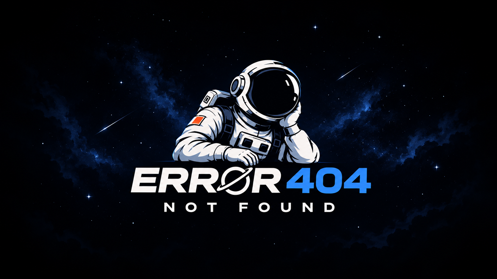

# Error 404 — Earth System Trend Detective
### NASA Space Apps Challenge 2026 · Global Finalist Project



> **Team Error 404** · NASA Space Apps Challenge 2026  
> *Interactive 3D Earth System Trend Detection, Multidecadal Satellite Observation, Statistical Anomaly Analysis & AI Foundation Model Telemetry*

[](https://spaceappschallenge.org/)
[](https://spaceappschallenge.org/)
[](https://www.typescriptlang.org/)
[](https://threejs.org/)
[](https://vitejs.dev/)

---

## 🌍 Executive Summary

**Earth System Trend Detective** is an interactive, scientific Earth observation and climate intelligence platform developed for the **NASA Space Apps Challenge 2026** by **Team Error 404**.

Addressing the challenge *"Be an Earth System Trend Detective!"*, the platform bridges high-resolution satellite remote sensing from NASA's Earth Observing System Data and Information System (**EOSDIS**) and Global Imagery Browse Services (**GIBS**) with a quantitative analytical workspace for discovering environmental trends, detecting extreme anomalies, analyzing seasonal cycles, and forecasting multi-decadal transformations across Earth's interconnected spheres.

---

## 🚀 Key Architectural Innovations

### 1. Dual-Workspace Experience
- **Explorer Mode (`/`):**
  - Interactive 3D planetary globe with real-time NASA GIBS satellite tile layers.
  - Centered intelligent search bar supporting geographic geocoding, layer filtering, and historical date jumping.
  - Tactile navigation tool rail (2D/3D projection, camera reset, Egypt & global hotspots, split-screen spatial compare, clipping export).
  - Ultra-compact timeline scrubber (1980–2026) with month-by-month temporal stepping and seasonal playback.
- **Investigation Workspace (`/investigation/:id`):**
  - Dedicated deep research environment launched seamlessly from any selected point or study area.
  - Real-time 3D Earth Sphere displaying live NASA satellite constellations (Terra, Aqua, OCO-2, GRACE-FO) in accurate orbital planes casting scanning light cones and surface spotlights onto Earth.
  - Multidecadal telemetry analysis deck with comparative split engines (Two Locations vs Two Temporal Epochs).

### 2. Rigorous Statistical & Anomaly Detection Suite
- **Monotonic Trend Detection:** Hirsch-Slack and Theil-Sen non-parametric median slopes, Mann-Kendall rank correlation ($\tau$), two-tailed statistical significance testing ($p$-values), and False Discovery Rate (FDR $q < 0.05$) correction.
- **Multivariate Correlation Matrix:** Real-time 5×5 Pearson correlation heatmap ($r$) uncovering atmospheric, terrestrial, and oceanic coupled dynamics.
- **2D Bivariate Analysis:** Simultaneous dual-variable spatial scatter and classification with marginal distribution histograms.
- **Standardized $Z$-Score ($\sigma$) Departure Series:** Isolating extreme climate events, marine heatwaves, and severe drought pulses from background climatological cycles.
- **Polar Seasonality Radar:** 12-month cyclical radial mapping identifying phenological phase shifts and seasonal amplitude amplification.

### 3. Integrated Earth Observation Datasets & Satellite Sensors
- **NASA MODIS Terra & Aqua:**
  - Land Surface Temperature (LST Day/Night — `MOD11C3` / `MYD11C3`)
  - Normalized Difference Vegetation Index (NDVI — `MOD13C2`)
  - Sea Surface Temperature (SST 11μm — `MODIS_Aqua_L3_SST`)
- **NASA MERRA-2 & GLDAS:**
  - 2-Meter Air Temperature & Planetary Heat Anomalies (`M2TMNXSLV`)
  - Precipitation Accumulation & Flux
  - Multi-layer Root Zone Soil Moisture
- **Satellite Partner Missions:**
  - CSA RADARSAT Constellation Mission (RCM SAR Synthetic Aperture Radar)
  - NASA/CNES SWOT (Surface Water and Ocean Topography elevation)
  - NASA OCO-2 (Atmospheric Carbon Dioxide flux)

### 4. Planned AI Foundation Model Architecture
- **Time-Series Foundation Models:** Probabilistic multi-horizon forecasting (Amazon Chronos-2) and zero-shot temporal anomaly classification (CMU MOMENT).
- **Geospatial Multimodal Models:** Multi-sensor spatial change detection and land-cover transformation (IBM/NASA TerraMind & Prithvi-EO-2.0, AnySat).

---

## 🛠️ Technology Stack

| Domain | Technologies & Libraries |
| :--- | :--- |
| **Frontend & UI** | TypeScript (Strict Mode), Vite, CSS3 Modern Glassmorphism, Geist Sans & Mono Fonts |
| **3D Graphics & Shaders** | Three.js, WebGL2, GLSL Custom Shaders (Atmospheric Fresnel, Nadir Cones, Radar Ripples) |
| **Scientific Computation** | Theil-Sen Median Regression, Mann-Kendall Test, Kendall $\tau$, Pearson $r$, Climatological Z-Score |
| **Animation & Motion** | GSAP (GreenSock), Motion Division, Hardware GPU-Accelerated Pipelines |
| **Data & Telemetry APIs** | NASA EOSDIS / GIBS WMTS, NASA Giovanni, AppEEARS, NOAA CDO, USGS EROS, AWS Open Data |

---

## 💻 Getting Started & Local Development

### Prerequisites
- **Node.js:** version `20.19+` or `>= 22.12.0`
- **Package Manager:** `npm` (version 9+)

### Installation
```bash
# Clone the repository
git clone https://github.com/Adel-333/Error-404-Earth-System-Trend-Detective.git
cd Error-404-Earth-System-Trend-Detective

# Install dependencies
npm install

# Start development server
npm run dev
```

The application will launch on `http://localhost:5173/`.

### Production Build
```bash
# Type check and build optimized bundle
npm run build

# Preview production build locally
npm run preview
```

---

## 👥 Team Error 404 · NASA Space Apps Challenge 2026

- **Lead AI & Software Engineering:** Team Error 404
- **Challenge:** Be an Earth System Trend Detective!
- **Event:** NASA International Space Apps Challenge 2026

---

*This project is built using public satellite data provided by NASA and international space agency partners. NASA does not endorse non-U.S. Government entities.*
