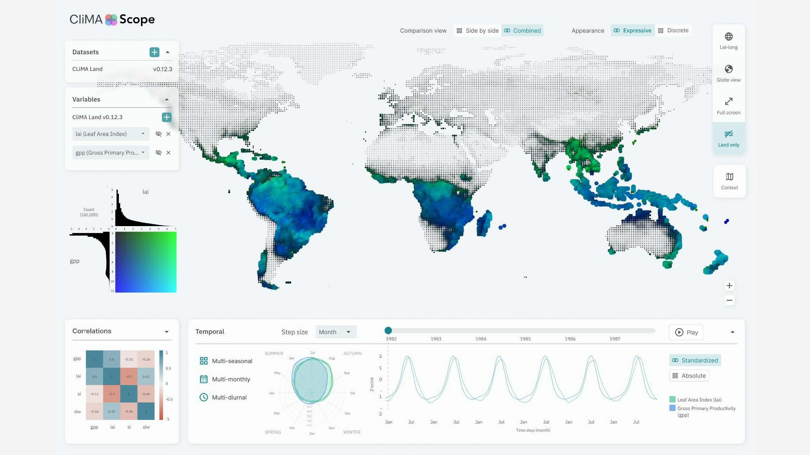

# CliMAScope reference analysis

**Reviewed:** 3 November 2026  
**Reference:** [CliMAScope public repository](https://github.com/datavisprogram/climascope), [Caltech interface image](https://www.caltech.edu/about/news/data-to-discovery-art-climate), and [IEEE VIS 2025 paper listing](https://hotspot.ieeevis.org/year/2025/program/paper_a744e0f2-d891-4fd6-b3a0-d6e2f9227708.html).

## Scope and evidence

The repository was inspected through its public GitHub file tree and individual source files. It was **not cloned**, following the project instruction. The root repository contains `dev`, `docs`, and `tests`. The README describes it as an interactive viewer for CliMA simulations and historical data. The IEEE VIS listing frames the finished system as a tool for analysis, comparison, validation, and correlation mapping between observations and climate land-model output.

The public tree makes an important distinction: `tests/d3/` and `tests/threejs/` are experiments. The Caltech image is the best accessible representation of the composed interface. EarthTrend should borrow the information architecture and interaction principles, not copy the implementation or recreate the image.

## Source inventory

| Area | Evidence inspected | What it establishes |
|---|---|---|
| Root | `README.md` | Tests and a separate dev area; the five named D3 files and a Three.js proof of concept are listed explicitly. |
| D3 index | `tests/d3/index.html` | A small experiment launcher, not a product shell. |
| Three.js | `tests/threejs/index.html`, `color_selection.js`, `index.css`, `package.json`, README | A Vite + Three.js experiment with timeline, playback speed, map context, region selection, highlight outline, and difference toggles. |
| Caltech interface | Official image and article | Finished interface organizes controls around a geographic display, legends, correlations, and temporal views. |
| IEEE VIS | Official program page | The intended research workflow is comparison and validation of observations with model output, not generic climate reporting. |

## Experiments: useful ideas and limits

| Experiment | Actual mechanism | Keep for EarthTrend | Do not carry over |
|---|---|---|---|
| `d3_dots_2.html` | Longitude/latitude circles encode LAI and GPP through color/size. An interactive 2D legend can brush ranges, with a time slider, resolution slider, playback, tooltips, and reset. | Bivariate legend as a real filter; direct location inspection; an explicit time control. | Unexplained RGBA mixing, hard-coded value ranges, and an unframed full-page SVG. |
| `d3_dots_filtering_higher_res.html` | Higher-resolution dot field with size, bivariate color, filtering, and black out-of-range/zero cells. | “No data / excluded” has its own treatment; sampling and resolution must be visible. | Turning non-selected data black as a default; this reduces legibility in a trend surface. |
| `d3_lines_color_options.html` | Alternative color encodings for line/point values and bivariate measures. | Allow encoding choice only when it changes a stated analytical task. | Decorative palette choice without legend or interpretation. |
| `d3_squares.html` | Square-mark spatial encoding exploration. | Cell/grid view can expose native data resolution. | Using square marks as a stylistic replacement for geography. |
| `d3_temporal_waveform_6_years_rotated_autoplay.html` | Paired radial seasonal view and waveform, standardized by year; slider reveals corresponding points/links and playback advances time. | Seasonal profile beside a series can reveal effects annual means hide; linked selection is valuable. | Autoplay as a default; standardization must be declared and reversible. |
| Three.js `color_selection.js` | 3D proof of concept with context/difference/selection toggles and a timeline/play controls. | Context layers, selection boundaries, compare/difference controls, and a real timeline. | Requiring a 3D renderer before the trend-analysis workflow is working. |

## Finished-interface reading

The visible interface uses the geographic surface as the primary work area. It gives controls stable edges instead of turning every concept into a floating card:

- A compact left rail holds dataset and variable selection.
- The center holds a broad map with point marks and context geography.
- A small top strip switches comparison and appearance modes.
- A right tool rail changes map/context mode.
- A lower band groups correlation, seasonal, and time-series views around one temporal controller.
- The bivariate legend is a view-specific instrument: distributions accompany color interpretation and the legend can be used for filtering.

It is dense, but hierarchy comes from position and whitespace rather than oversized headings or marketing copy. Typography is small and operational. Thin neutral boundaries make controls readable without competing with data. Color belongs mostly to encodings, especially green/blue in the reference, while application chrome stays muted.

## Design translation for EarthTrend Detective

EarthTrend is a trend-analysis workspace, so its analysis model is different from CliMAScope’s climate-model comparison. The interface should retain the useful structure while putting different evidence first.

| CliMAScope concept | EarthTrend equivalent |
|---|---|
| Two-variable bivariate spatial display | Trend slope plus quality/significance encoding, only after the method has generated it. |
| Combined / side-by-side model comparison | Region, time-window, or source comparison; a comparison must declare what differs. |
| Appearance modes | Continuous trend surface vs. discrete native-grid/cell view. |
| Correlation matrix | Optional relationship view for compatible variables, never a replacement for a trend result. |
| Radial seasonality + waveform | Seasonal trend profile plus a time series when seasonal aggregation is part of the question. |
| Timeline / playback | Temporal coverage and selection control; playback is secondary to precise time selection. |
| Context layers | Boundaries, land/water, elevation, and selected ROI with clear provenance. |

### Required EarthTrend evidence order

1. Dataset/source, unit, coverage, grid resolution, and quality flags.
2. Region and temporal aggregation selection.
3. Spatial trend surface with an explicit slope legend and separate no-data state.
4. Location inspector: series, trend slope, confidence interval, p-value/multiple-testing status, autocorrelation/seasonality notes, and sample count.
5. Optional comparison and seasonal views, only for a compatible source/method.

## Implementation observations

The current EarthTrend redesign implements the spatial-workbench layout principles without presenting a fabricated result:

- left layer/dataset drawer;
- full spatial canvas with contextual NASA Blue Marble imagery;
- combined/side-by-side and expressive/discrete controls;
- a temporal slider and playback state;
- selected-location inspector where trend, interval, significance, and quality are explicitly unavailable until an approved source and method are connected;
- chart fixture labelled as interface-only data.

The next data adapter must replace the fixture with typed values and preserve the same “analysis unavailable” state whenever a metric cannot be supported. No backend was selected or implemented.

## Review verdict

The reference supports a focused, scientific work surface. It does not justify copying its screen, data, or experimental renderers into EarthTrend. The updated UI uses its spatial hierarchy, small-control density, temporal layout, and linked-view logic while keeping this project’s task specific: Earth-system trends and the evidence required to report them.
